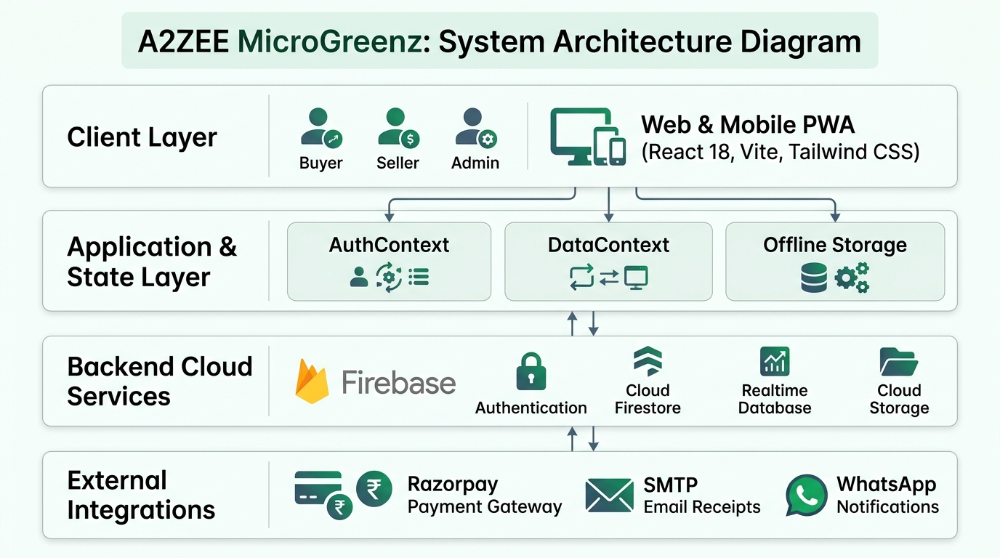
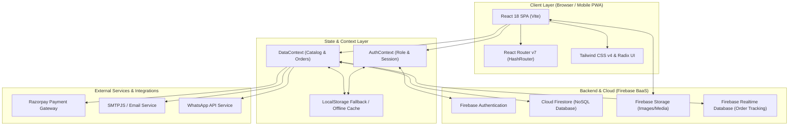
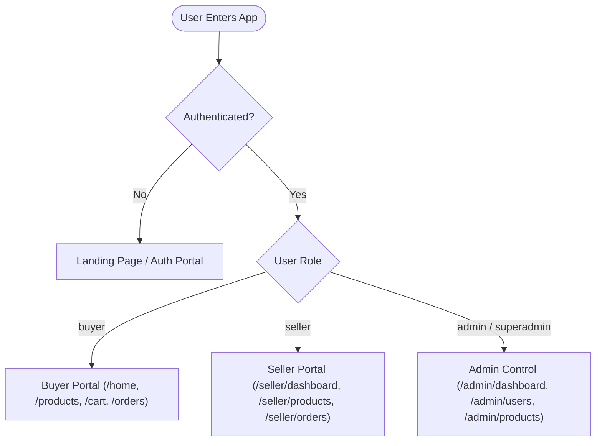
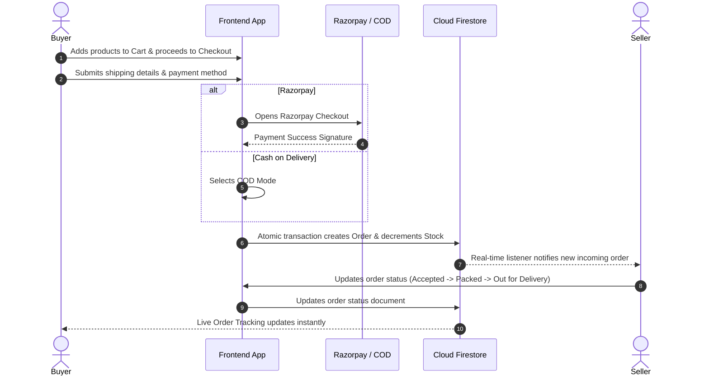

# System Architecture: A2ZEE MicroGreenz

A high-level, clear overview of the architecture, data flow, and components powering the **A2ZEE MicroGreenz** Progressive Web Application (PWA).



---

## 1. High-Level Architecture Diagram



---

## 2. Core Architectural Layers

### A. Presentation & UI Layer
* **Framework**: React 18 with TypeScript and Vite bundler.
* **Routing**: React Router v7 using `HashRouter` for static host compatibility (GitHub Pages, Netlify, Firebase Hosting).
* **Styling**: Tailwind CSS v4, Radix UI accessible primitives, Lucide React icons, and Sonner notifications.
* **PWA Features**: Service workers, offline caching, and responsive mobile-first navigation (`BottomNav`).

### B. State & Context Layer
* **`AuthContext`**: Handles user authentication, session persistence, and role-based permissions (`buyer`, `seller`, `admin`, `superadmin`).
* **`DataContext`**: Manages real-time catalog items, curated boxes, cart items, order transactions, and reviews.
* **`localStorage` Fallback**: Dual-layer architecture allowing the application and automated tests to run offline or with mock storage when Firebase is disconnected.

### C. Backend Cloud Services (Firebase)
* **Authentication**: Email/Password, Phone OTP, and Google Sign-in.
* **Cloud Firestore Collections**:
  * `users/`: User profiles, role declarations, and account approval statuses.
  * `products/`: Seller catalog with stock counters, pricing, and approval flags.
  * `orders/`: Multi-seller order documents, line items, shipping addresses, and statuses.
  * `reviews/`: Product ratings and customer reviews.
  * `catalogue_products/` & `curated_boxes/`: Pre-seeded default collections.
* **Firebase Storage**: CDN asset storage for product images and certificates.
* **Firebase Realtime DB**: Fast real-time sync for live order state transitions.

### D. External Services
* **AI Recommendation Agent**:
  * Powered by Google Gemini 2.5 Flash API (`gemini-2.5-flash`).
  * Floating widget with custom A2ZEE smiling mascot avatar (`/ai_mascot.png`).
  * Provides conversational nutritional guidance, tailored product recommendations, recipe ideas, and grow kit advice.
* **Payment Processing**: Razorpay checkout modal supporting UPI, Credit/Debit cards, Net Banking, and Cash on Delivery (COD).
* **Communication**:
  * SMTPJS for automated order receipts and transactional emails.
  * WhatsApp API redirect for customer care and order dispatch messaging.

---

## 3. Role-Based Access Control (RBAC)



* **Buyer**: Browse catalog, add to cart, checkout (Razorpay/COD), track deliveries, review products.
* **Seller**: Inventory management, product listing (pending admin review), order fulfillment (`accepted` → `packed` → `out_for_delivery` → `delivered`).
* **Admin / SuperAdmin**: Seller account approvals, product moderation, customer dispute reviews, financial dashboard.

---

## 4. Order & Payment Lifecycle



---

## 5. CI/CD & Automated Testing Pipeline

```mermaid
flowchart LR
    DevCommit[Code Commit] --> GitPush[Push to GitHub main]
    GitPush --> GHActions[GitHub Actions CI Runner]
    subgraph CI ["Automated CI Pipeline (.github/workflows/ci.yml)"]
        SetupNode[Setup Node 20]
        InstallDeps[Install Dependencies]
        ViteBuild[npm run build]
        StartServer[Start Vite Dev Server]
        SeleniumE2E[Run E2E Suite (Admin, Buyer, Seller)]
        GenReport[Export CSV & Excel Reports]
    end
    GHActions --> SetupNode --> InstallDeps --> ViteBuild --> StartServer --> SeleniumE2E --> GenReport
    GenReport --> Artifacts[(Downloadable Excel Test Artifacts)]
```

* **Build Validation**: Validates Vite production bundle compilation.
* **E2E Automation**: Runs headless Chrome with Selenium WebDriver testing authentic end-to-end user journeys for Admin, Buyer, and Seller roles.
* **Reporting**: Automatically exports detailed `.csv` and styled `.xlsx` reports uploaded directly to GitHub Actions artifacts.
